# Spacecraft Sensor Simulation & FDIR

A multithreaded spacecraft sensor simulator developed in **C++20**, featuring sensor acquisition, periodic data processing, and Fault Detection, Isolation, and Recovery (FDIR) monitoring.

The project demonstrates concepts relevant to embedded and aerospace software, including concurrent programming, thread-safe communication, watchdog monitoring, and fault injection.

The simulation runs on Linux using a simulated I2C bus, without requiring physical hardware.

## 1. Key Features

- **Multithreaded architecture:** Independent threads for acquisition, processing, and fault monitoring.
- **Sensor simulation:** Three IMUs at 100 Hz and two GNSS receivers at 20 Hz.
- **Periodic processing:** Sensor data processing at 50 Hz.
- **Thread-safe communication:** Shared queues for exchanging sensor measurements.
- **FDIR monitoring:** Sensor health monitoring, data validity checks, and an independent processing watchdog.
- **Fault injection:** Configurable sensor failures and communication dropouts.
- **Logging and visualization:** CSV logs and Python-based plotting.

## 2. System Architecture

The simulator uses independent threads for sensor acquisition, data processing, and fault monitoring. Sensor measurements are generated through a simulated I2C bus and exchanged using thread-safe queues.

The FDIR component independently monitors sensor health and processing activity.

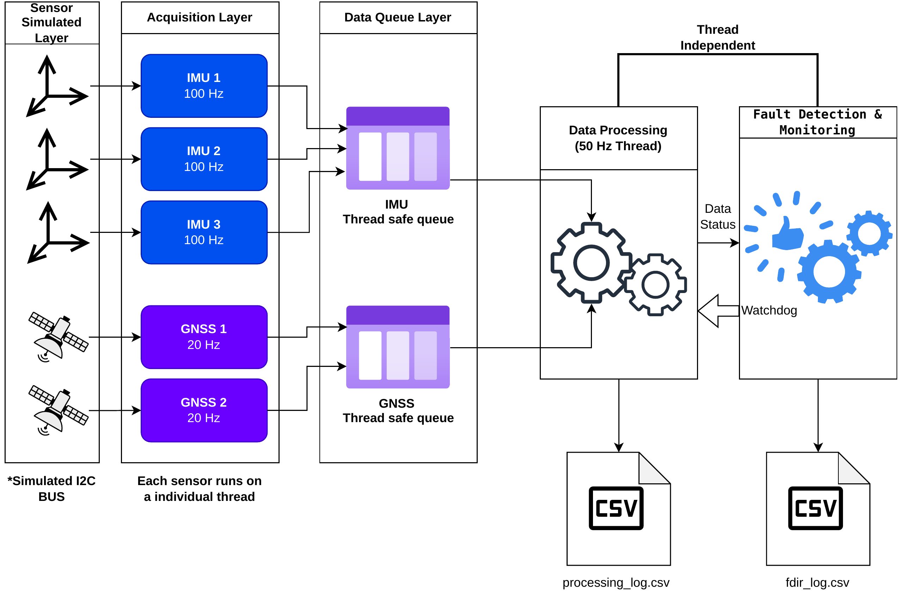

## 3. Simulation Scenarios & Results

Five scenarios evaluate the system under nominal conditions, sensor failures, and processing interruptions.

Each scenario produces CSV logs that can be visualized through:

- **FDIR plots:** Health status of sensors, processed outputs, and the processing component.
- **Processing plots:** IMU/GNSS measurements and output validity.

### 3.1. Nominal Operation

All sensors operate normally throughout the simulation.

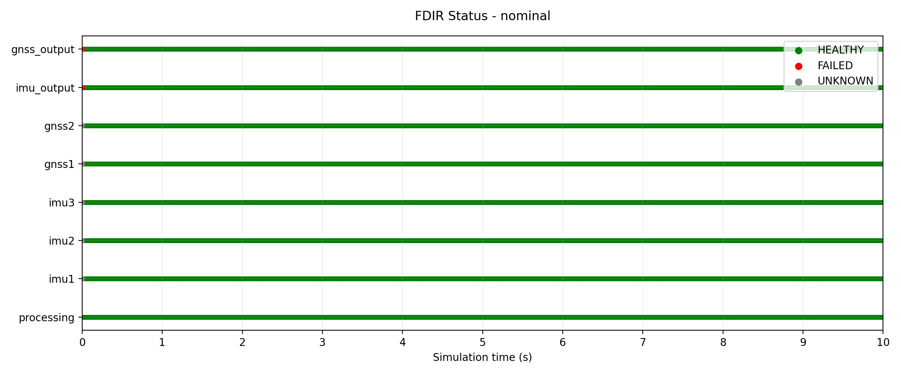

All three IMUs, both GNSS receivers, and the processing component remain `HEALTHY`. Valid sensor measurements are continuously produced, establishing a baseline for comparison with fault scenarios.

<details>
<summary>View processing plot</summary>

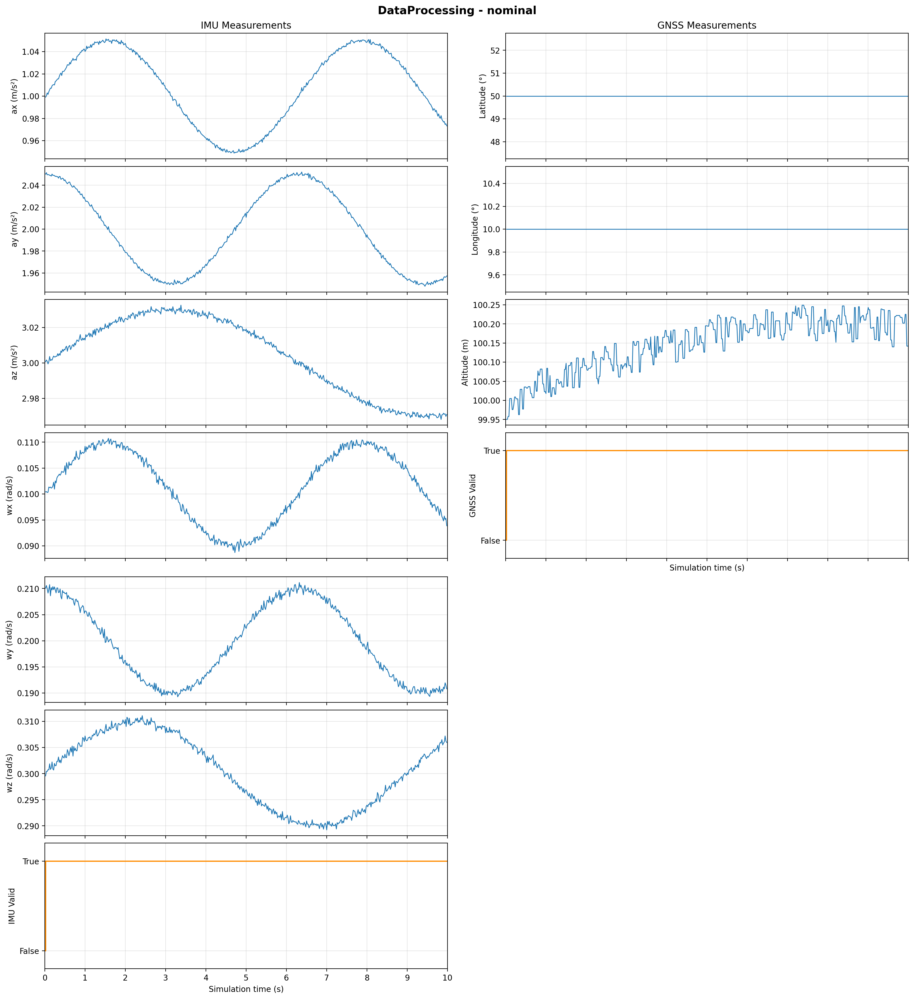

</details>

### 3.2. Sequential IMU Failures

Permanent failures are introduced in IMU 1, IMU 2, and IMU 3 at 3, 5, and 7 seconds, respectively.

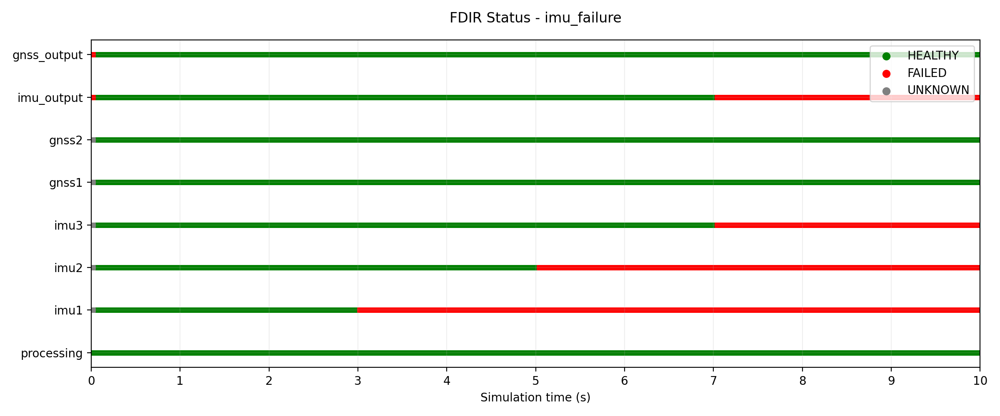

The FDIR component detects each failure while the system continues producing valid inertial measurements as long as one IMU remains available.

After the final failure, the aggregated IMU output transitions to `FAILED`, and the IMU validity flag becomes false. GNSS measurements remain available.

<details>
<summary>View processing plot</summary>

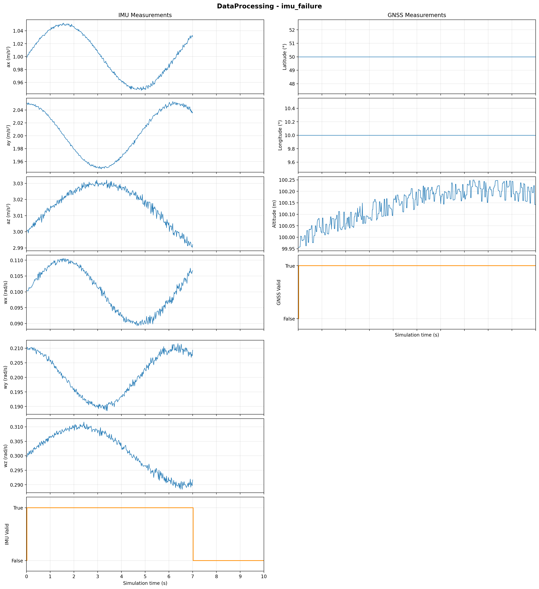

</details>

### 3.3. Temporary GNSS Dropout

Both GNSS receivers experience a 500 ms dropout between 4.0 and 4.5 seconds.

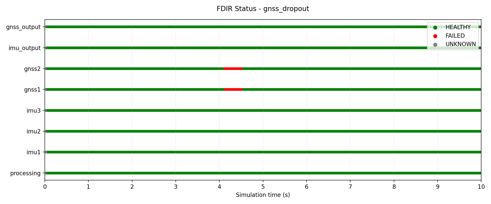

Both receivers temporarily transition to `FAILED`, but the aggregated GNSS output remains `HEALTHY` because the last available measurements are still within the **one-second freshness threshold**.

Once acquisition resumes, both receivers return to `HEALTHY`, and GNSS output validity remains uninterrupted.

<details>
<summary>View processing plot</summary>

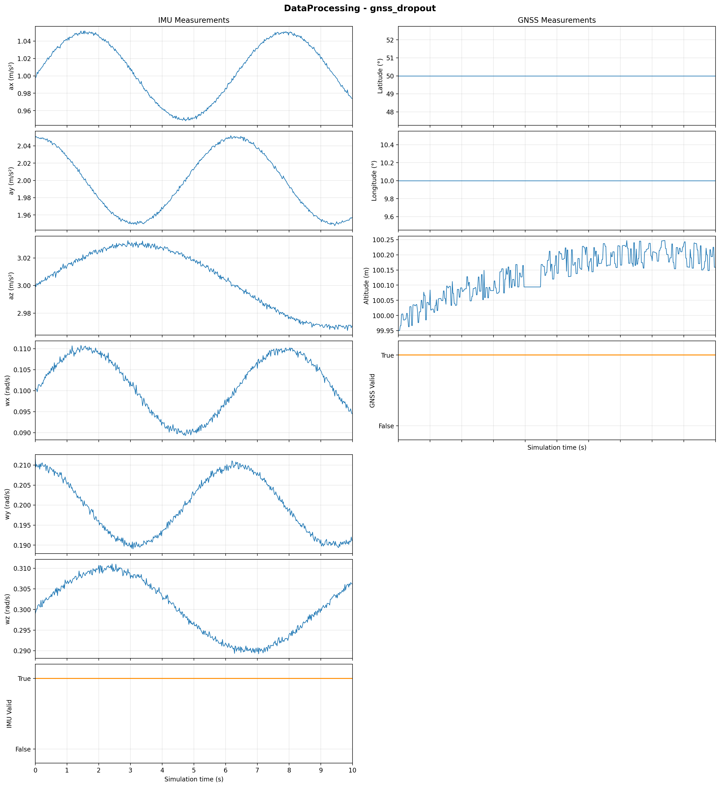

</details>

### 3.4. Total GNSS Failure

Both GNSS receivers permanently stop producing measurements at 3 seconds.

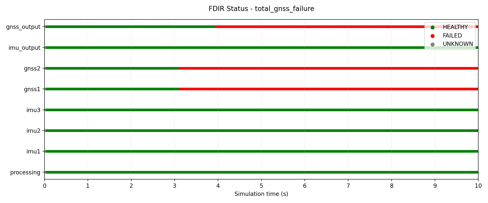

The individual receivers transition to `FAILED` shortly after the interruption.

At approximately 4 seconds, the last available GNSS measurements exceed the one-second freshness threshold. Consequently, the aggregated GNSS output becomes `FAILED`, and the GNSS validity flag becomes false.

IMU acquisition and processing remain operational.

<details>
<summary>View processing plot</summary>

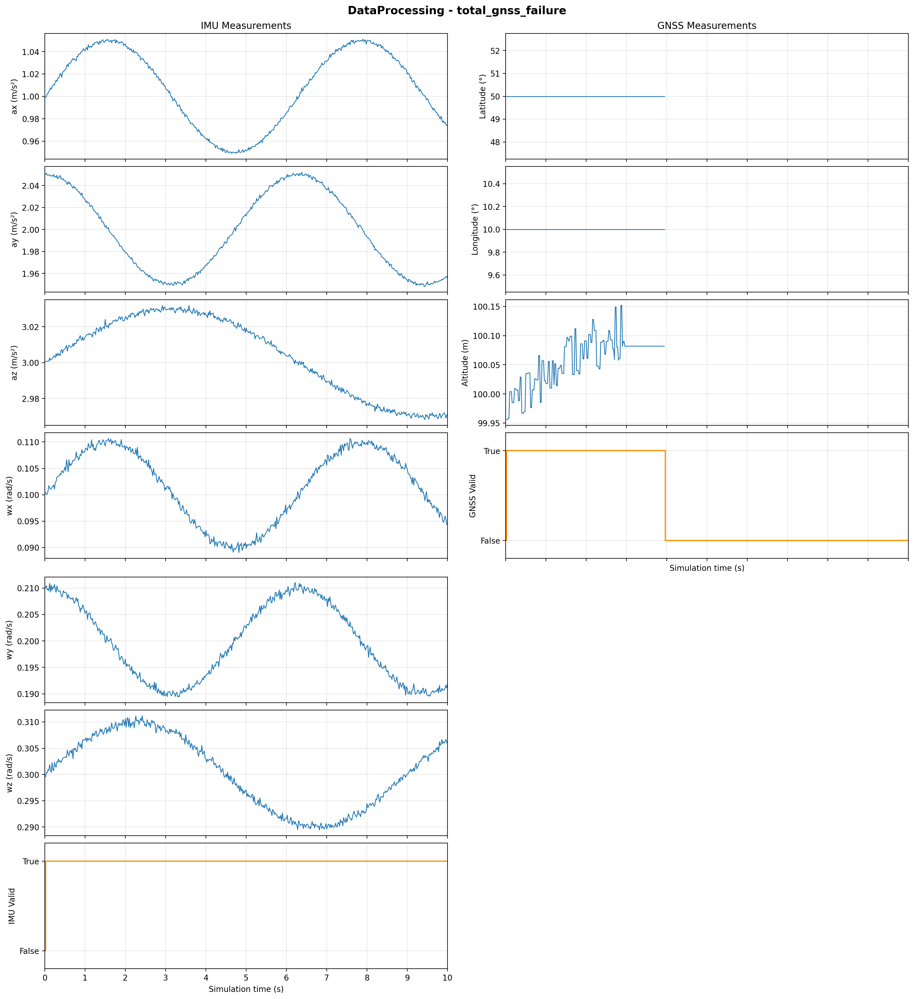

</details>

### 3.5. Processing Failure

The processing component is intentionally stopped at 5 seconds to evaluate the independent FDIR watchdog.

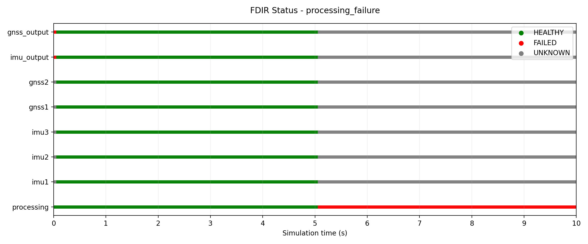

The watchdog detects the interruption and marks the processing component as `FAILED`.

Individual sensor and aggregated output states transition to `UNKNOWN`, distinguishing unavailable health information from confirmed sensor failures.

This demonstrates the importance of independent monitoring in detecting processing interruptions.

<details>
<summary>View processing plot</summary>

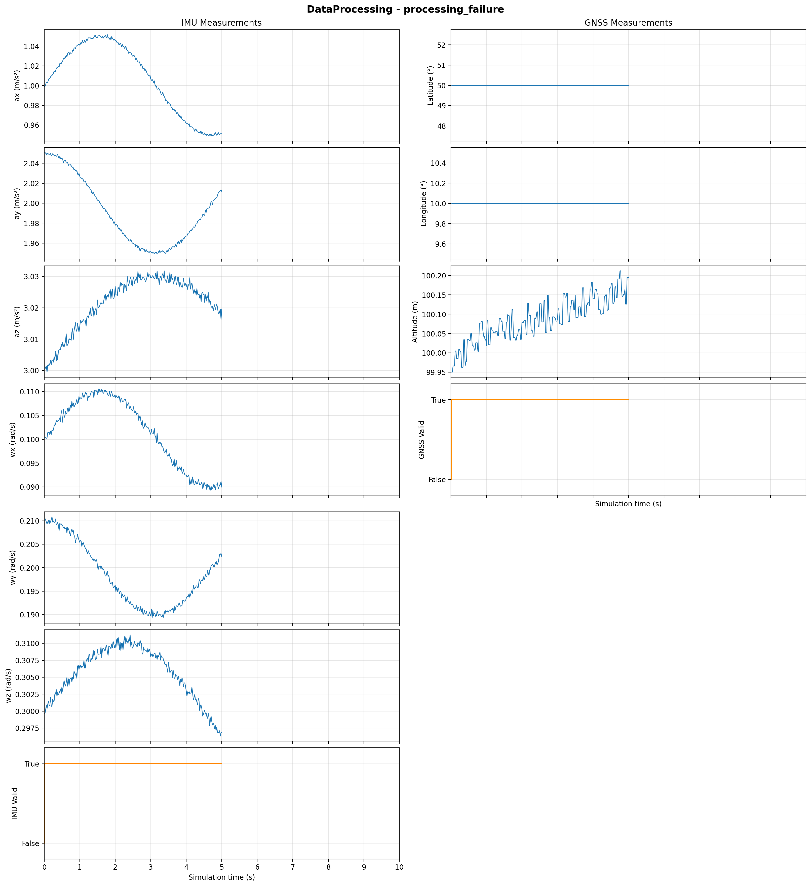

</details>

## 4. Build & Run

### Requirements

- Linux
- C++20-compatible compiler (GCC)
- CMake and Make
- Python 3, pandas, and matplotlib (optional, for plotting)

### Build

From the project's root directory:

```bash
cmake -S . -B build
cmake --build build
```

### Run

```bash
./build/flight_sim
```

All five scenarios execute automatically, each lasting approximately 10 seconds.

Simulation logs are saved in `results/`.

### Post-Processing

To generate plots from the CSV logs:

```bash
python3 plot_results.py
```

Each scenario generates:

- `<scenario>_processing_log.csv` — Processed sensor measurements.
- `<scenario>_fdir_log.csv` — Sensor health and fault monitoring results.

Generated plots are saved in `results/`.

Reference logs and plots are available in `results_example/`, allowing results to be inspected without running the simulation.

## 5. Unit Testing

Unit tests validate the thread-safe queue and simulated I2C bus using the C++ Standard Library, without external testing frameworks.

### ThreadSafeQueue

Tests cover FIFO ordering, empty queue behavior, clearing, and concurrent access.

```bash
g++ -std=c++20 -pthread -Iinclude tests/test_queue.cpp -o test_queue
./test_queue
```

### SimulatedI2CBus

Tests cover valid readings, deterministic measurements, temporary/permanent dropouts, and duplicate I2C addresses.

```bash
g++ -std=c++20 -I. -Iinclude tests/test_simulated_bus.cpp -o test_simulated_bus
./test_simulated_bus
```

## 6. Project Structure

```text
spacecraft-sensor-fdir/
├── include/                  # C++ headers
├── src/                      # C++ implementation
├── simulation/               # Simulated I2C bus and scenarios
├── tests/                    # Unit tests
│   ├── test_queue.cpp
│   └── test_simulated_bus.cpp
├── docs/
│   └── architecture.png
├── results/                  # Generated logs and plots
├── results_example/          # Reference simulation results
├── build/                    # Generated build files
├── CMakeLists.txt
├── plot_results.py
└── README.md
```

The `build/` and `results/` directories are generated during execution and are not required in the repository.

## 7. Implementation Scope

The project focuses on sensor simulation, periodic processing, and fault monitoring using a software-based I2C interface.

Automatic recovery actions are not implemented. Execution on general-purpose Linux does not provide hard real-time guarantees.
